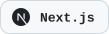
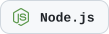
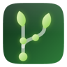
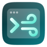
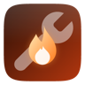
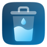
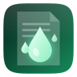

<picture>
  <source media="(prefers-color-scheme: dark)" srcset="assets/banner-dark.svg">
  
</picture>

<p align="center">
  <a href="https://tanawat.dev/"></a>
  <a href="https://vtxlabs.app/"></a>
  <a href="https://www.linkedin.com/in/tanawat-pinthongpan-683a84167/"></a>
</p>

<br/>

## 🌑 `> whoami`

```js
const tanawat = {
    alias: "TanawatDEVz",
    location: "Thailand 🇹🇭",
    role: "Fullstack developer",
    tagline: "I build the tools I use.",
    shipping: "web apps since July 2017",
    building: "VTX — 11 desktop apps, one element each",
    focus: ["Desktop Apps", "Fullstack", "Web Security", "System Design"],
    currentWeapon: "Rust + Tauri + React + TypeScript",
    philosophy: "// The best code is the one no one sees, but everyone relies on.",
};
```

<br/>

## ⚡ `> stack --core`

> 💪 _What I'm strongest in today: the ones I reach for first. Everything else I've shipped with is further down, under `> weapons --history`._

<p align="center">
  <sub><b>Languages</b></sub><br>
  <picture><source media="(prefers-color-scheme: dark)" srcset="assets/stack/typescript-dark.svg"></picture>
  <picture><source media="(prefers-color-scheme: dark)" srcset="assets/stack/rust-dark.svg"></picture>
</p>

<p align="center">
  <sub><b>Frontend</b></sub><br>
  <picture><source media="(prefers-color-scheme: dark)" srcset="assets/stack/react-dark.svg"></picture>
  <picture><source media="(prefers-color-scheme: dark)" srcset="assets/stack/next-js-dark.svg"></picture>
  <picture><source media="(prefers-color-scheme: dark)" srcset="assets/stack/tailwind-css-dark.svg"></picture>
  <picture><source media="(prefers-color-scheme: dark)" srcset="assets/stack/ant-design-dark.svg"></picture>
  <picture><source media="(prefers-color-scheme: dark)" srcset="assets/stack/shadcn-ui-dark.svg"></picture>
</p>

<p align="center">
  <sub><b>Mobile</b></sub><br>
  <picture><source media="(prefers-color-scheme: dark)" srcset="assets/stack/react-native-dark.svg"></picture>
  <picture><source media="(prefers-color-scheme: dark)" srcset="assets/stack/flutter-dark.svg"></picture>
</p>

<p align="center">
  <sub><b>Backend</b></sub><br>
  <picture><source media="(prefers-color-scheme: dark)" srcset="assets/stack/node-js-dark.svg"></picture>
  <picture><source media="(prefers-color-scheme: dark)" srcset="assets/stack/nestjs-dark.svg"></picture>
  <picture><source media="(prefers-color-scheme: dark)" srcset="assets/stack/express-dark.svg"></picture>
</p>

<p align="center">
  <sub><b>Data &amp; cloud</b></sub><br>
  <picture><source media="(prefers-color-scheme: dark)" srcset="assets/stack/postgresql-dark.svg"></picture>
  <picture><source media="(prefers-color-scheme: dark)" srcset="assets/stack/mongodb-dark.svg"></picture>
  <picture><source media="(prefers-color-scheme: dark)" srcset="assets/stack/supabase-dark.svg"></picture>
  <picture><source media="(prefers-color-scheme: dark)" srcset="assets/stack/vercel-dark.svg"></picture>
</p>

<p align="center">
  <sub><b>Tooling &amp; AI</b></sub><br>
  <picture><source media="(prefers-color-scheme: dark)" srcset="assets/stack/docker-dark.svg"></picture>
  <picture><source media="(prefers-color-scheme: dark)" srcset="assets/stack/vitest-dark.svg"></picture>
  <picture><source media="(prefers-color-scheme: dark)" srcset="assets/stack/claude-code-dark.svg"></picture>
</p>

<sub>Logos from <a href="https://simpleicons.org">Simple Icons</a> (CC0); the Rust logo is the Rust Foundation's, CC BY-SA 4.0 (<a href="assets/stack/NOTICE.md">notice</a>). Names and logos belong to their owners.</sub>

<br/>

## 🌌 `> ls ~/vtx`

> 🧪 _The tools I use every day, so I built my own. Eleven desktop apps in Rust + Tauri, one element each, all built solo._

| App | What it does |
|---|---|
|  **Lapis** · _stone_ | Database client. PostgreSQL, MySQL / MariaDB, SQLite, SQL Server, MongoDB and Redis in one window. |
|  **Fulmen** · _lightning_ | API client. HTTP, GraphQL, WebSocket, gRPC, SSE and MCP. Requests leave from Rust, not a browser. |
|  **Silva** · _wood_ | Git client. Every action can be undone, and it runs your own git: hooks, LFS and signing included. |
|  **Ventus** · _wind_ | SSH client. Reads your `~/.ssh/config` and agent, and checks the host key before sending anything. |
|  **Ignis** · _fire_ | Dev toolbox. Paste anything and it knows what it is: JSON, JWT, Base64, timestamps, cron, cURL. |
|  **Aqua** · _water_ | Mac cleaner that knows a developer's disk: build folders, tool caches, simulators, Docker. |
|  **Cuprum** · _copper_ | Code editor that traces where your data goes. A personal build. |
|  **Lux** · _light_ | Video maker. Short videos from a script, with a live preview of every scene. A personal build. |
|  **Mercurius** · _quicksilver_ | Mail. Gmail and Outlook accounts in one inbox, stored on your Mac. A personal build. |
|  **Crystallum** · _crystal_ | Remote desktop from your Mac to a Windows PC. A personal build. |
|  **Ros** · _dew_ | Notes as plain Markdown files that the other apps write into. |

<sub>Cuprum, Lux, Mercurius and Crystallum are personal builds. Sorry, you'll probably never get to use them 😏</sub>

<p align="center">
  
  
  
  
  
</p>

- 🔌 **No account. No cloud. No tracking.** Everything they keep stays on your own machine, and they go online only for what you connect them to or ask them to do. The one extra: four of them check for updates once a day, and you can turn that off.
- 🔍 **They show their work.** Silva lists every git command it runs, and Aqua says why each item is safe to remove.
- ↩️ **Mistakes come back.** Silva can undo any action, and Lapis keeps the SQL that reverses each write.

> Most of the family is private while it grows. Lapis and Fulmen have public preview builds at [**vtx-lapis-release**](https://github.com/tanawat011/vtx-lapis-release) and [**vtx-fulmen-release**](https://github.com/tanawat011/vtx-fulmen-release), and free web tools plus the whole family live at [**vtxlabs.app**](https://vtxlabs.app/).

<br/>

## ⚔️ `> weapons --current`

> 🔥 _My daily driver stack — what I'm actively building with right now._

<p align="center">
  
  
  
  
  
  
  
  <br/>
  
  
  
  
  
  
</p>

<br/>

## 🤖 `> ai --always-on`

> 🧠 _AI is part of my daily workflow — coding, reviewing, and shipping with it. And yes, VTX was built with a LOT of AI help. It's 2026, I'm not hiding it._

<p align="center">
  
  
  
  
</p>

<br/>

## 🗡️ `> weapons --history`

> 🧾 _Everything I've worked with over the years — battle-tested and shipped._

<details>
<summary>🗡️ Languages</summary>
<br/>
<p align="center">
  
  
  
  
  
  
  
  
  
  
  
  
</p>
</details>

<details>
<summary>🛡️ Web Frameworks & UI</summary>
<br/>
<p align="center">
  
  
  
  
  
  
  
  
  
  
  
  
  
</p>
</details>

<details>
<summary>🖥️ Desktop</summary>
<br/>
<p align="center">
  
  
  
  
</p>
</details>

<details>
<summary>📱 Mobile</summary>
<br/>
<p align="center">
  
  
  
</p>
</details>

<details>
<summary>🗄️ Databases & ORM</summary>
<br/>
<p align="center">
  
  
  
  
  
  
  
  
  
</p>
</details>

<details>
<summary>☁️ Cloud & Platforms</summary>
<br/>
<p align="center">
  
  
  
  
  
  
</p>
</details>

<details>
<summary>🕶️ DevOps & Tools</summary>
<br/>
<p align="center">
  
  
  
  
  
  
  
  
  
  
  
  
  
  
</p>
</details>

<br/>

## 📊 `> stats --honest`

> 🙃 _// stats that no one asked for, but here they are. Six jokes first, then four that are actually true._

| | Stat no one asked for |
|---|---|
| ☕&nbsp;**∞** | **Coffee consumed.** And counting… |
| 🐛&nbsp;**9,999+** | **Bugs created & fixed.** The 10,000th one is still in production. |
| 🔥&nbsp;**0** | **Stack Overflow visits.** Since 2024. Thanks, AI. |
| 🤖&nbsp;**AI&#8209;assisted** | **This profile.** Yes, AI helped. No, I'm not ashamed. |
| 🌙&nbsp;**Too&nbsp;many** | **Late-night deploys.** "It works on my machine." |
| 🔄&nbsp;**∞** | **Times I said "one more fix".** 3 hours later… |

**…and four that are actually true ✓**

| | Measured |
|---|---|
| 📦&nbsp;**142&nbsp;GB** | **Lapis's Rust build folder.** Just `target/`, measured once on 19 Nov 2026. My SSD would like a word. |
| 🎨&nbsp;**~88&nbsp;%** | **White, at the brightest.** The strongest text in my dark themes stops there. Tuned all day so your eyes don't burn. |
| 🧪&nbsp;**11** | **Apps named after elements.** Still missing one element: enough sleep. |
| 🌙&nbsp;**7&nbsp;%** | **Of my commits land between midnight and 6 AM.** 3,099 commits across the VTX repos, as of 19 Nov 2026. The other ones aren't exactly early either. |

<br/>

## 🐍 `> git log --shadow`

<p align="center">
  <picture>
    <source media="(prefers-color-scheme: dark)" srcset="https://raw.githubusercontent.com/tanawat011/tanawat011/output/github-snake-dark.svg">
    
  </picture>
</p>

<sub>Redrawn every day from my contribution grid by a GitHub Action in this repo (<a href="https://github.com/Platane/snk">Platane/snk</a>).</sub>

<br/>

<div align="center">

```
 ╔══════════════════════════════════════════════════════════════╗
 ║                                                              ║
 ║   "I use these tools every day,                              ║
 ║    so I built my own."                                       ║
 ║                                                              ║
 ║                                         — TanawatDEVz        ║
 ║                                                              ║
 ╚══════════════════════════════════════════════════════════════╝
```

</div>
